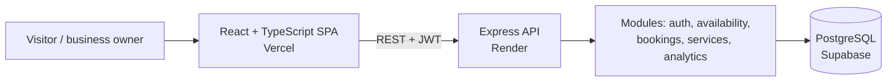

# Slotify

[](https://github.com/delmocss/slotify/actions/workflows/ci.yml)

Multi-tenant booking platform for small businesses: public booking page, availability engine, dashboard with metrics and CSV export.


## Demo

**https://slotify-client-theta.vercel.app** | [Public booking page](https://slotify-client-theta.vercel.app/b/demo-negocio) | API: https://slotify-50re.onrender.com

Demo account: `demo@demo.com` / `demo1234`

> Every demo login opens a private copy of the demo business that is discarded after 24 hours, so you can add or delete anything. The backend runs on a free tier: the first request can take 30-60 s if it was asleep.

## The problem

Many small businesses still manage appointments by phone, WhatsApp or spreadsheets. That leads to double bookings, no-shows nobody tracks and no reporting. Slotify gives them a public booking page, availability that respects their opening hours, and a dashboard with revenue and cancellations.

## Technically interesting

- **Race-safe bookings:** booking creation takes a PostgreSQL advisory lock per business, service and day, so two visitors cannot book the same slot at the same time.
- **Multi-tenancy:** users, organizations and memberships with roles. Every authenticated query is scoped to the organization in the JWT, and membership and role are re-checked against the database on each request, so a revoked user cannot keep using an old token.
- **Atomic registration:** user, organization, membership and business are created in a single transaction, rolled back on any failure, with collision-safe public slugs.
- **Private demo sandboxes:** each demo login clones a template business into a throwaway copy that is purged after 24 hours (capped at 300 active copies).
- **Secure public cancellation:** cancellation links use crypto-generated tokens, with rate limits on login and on public booking endpoints.

## Architecture



Data model, project structure and design principles: [docs/features-and-architecture.md](docs/features-and-architecture.md).

## Stack

| Layer | Technology |
| --- | --- |
| Frontend | React, TypeScript (strict), Vite, Tailwind CSS, TanStack Query, React Hook Form + Zod, Recharts |
| Backend | Node.js, Express, JWT, helmet, express-rate-limit, Zod |
| Database | PostgreSQL (schema.sql and numbered migrations) |
| Tests | Vitest, Supertest, real PostgreSQL in CI |
| Deployment | Vercel, Render, Supabase, GitHub Actions |

## Run it locally

```bash
cd server && npm install && cp .env.example .env   # set DATABASE_URL and JWT_SECRET
npm run dev                                         # http://localhost:4000

cd client && npm install && npm run dev             # http://localhost:3000
```

Create the tables with `server/src/database/schema.sql`. Full setup, environment variables, deployment and demo mode: [docs/development-and-deployment.md](docs/development-and-deployment.md).

## Tests

```bash
cd server && npm test
```

- **50 unit tests** (no database): availability logic, API surface (security headers, CORS, JWT rejection, validation, rate limits) and registration flow against a mocked pool.
- **12 integration tests** against a real PostgreSQL: demo sandbox isolation and purge, input hardening, dashboard data and CSV export. They run in CI with a Postgres service container; locally they need `TEST_DATABASE_URL` pointing to a throwaway database.
- CI also runs ESLint (`no-explicit-any` as an error), Prettier, TypeScript and the production build.

Not covered yet: the concurrent-booking lock and the frontend.

## Decisions and limitations

- No timezone support: "past slot" checks use the server clock (UTC).
- Availability is per service: there is no staff or resource model.
- No email notifications: the booking code and cancellation link are shown on the confirmation screen only.
- No frontend tests yet.

More detail in [docs/scope-and-limitations.md](docs/scope-and-limitations.md).

## Author

Sergio Del Moral | [LinkedIn](https://www.linkedin.com/in/sergio-del-moral-carrillo/) | [Portfolio](https://delmocss.github.io) | delmoralcs@gmail.com
