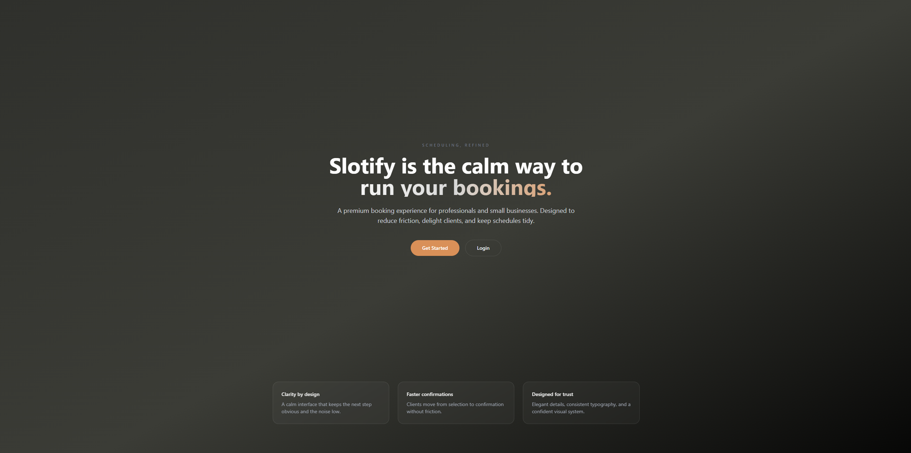
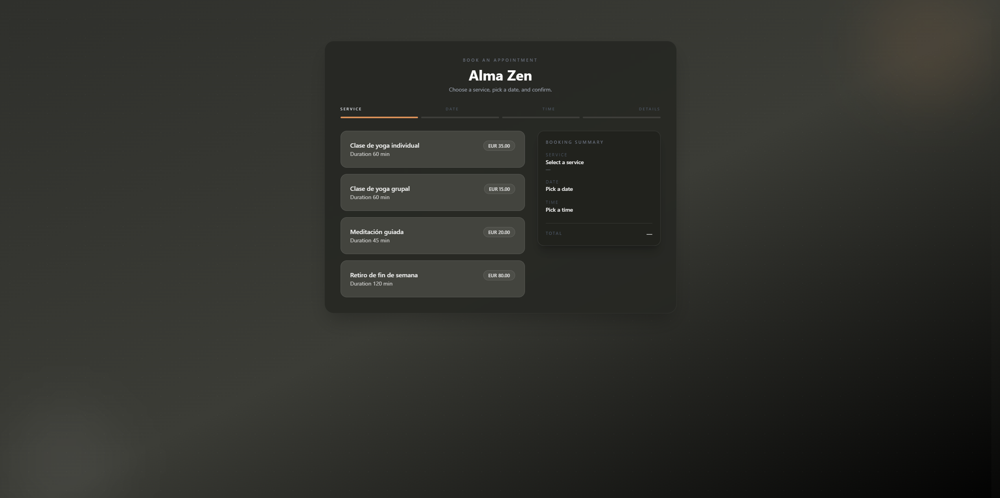
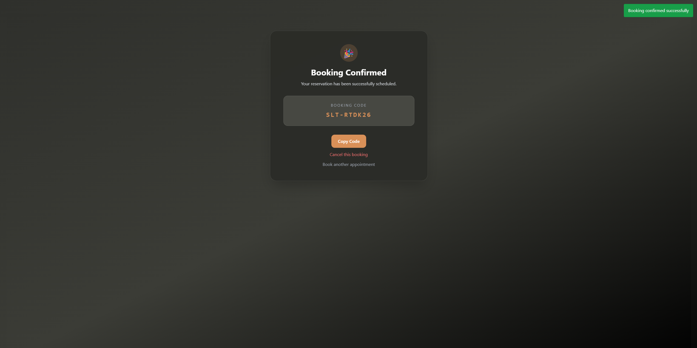
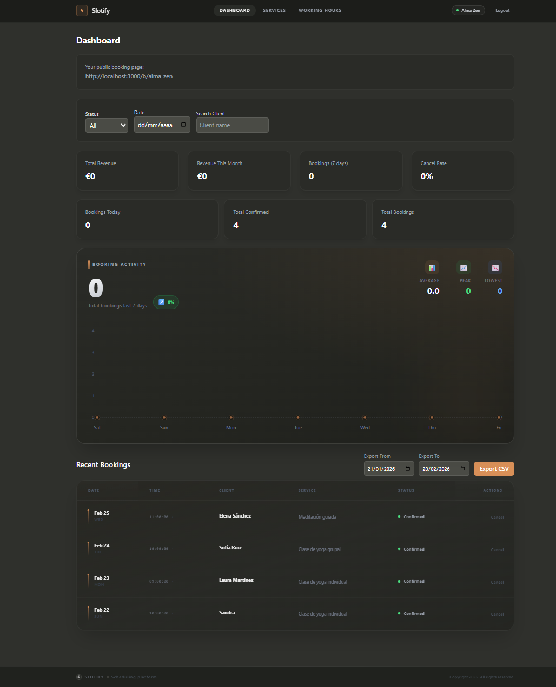
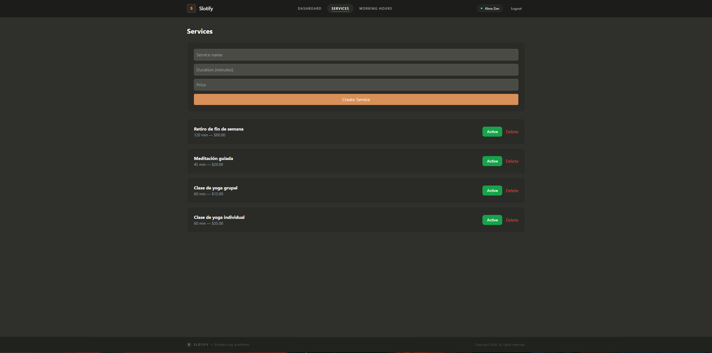
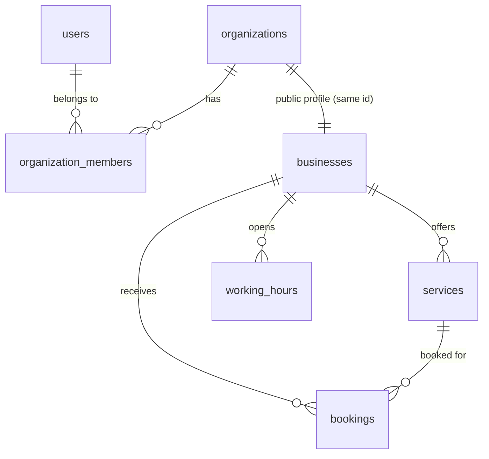

# 🚀 Slotify — Smart Booking SaaS Platform

> A production-oriented full-stack booking system designed to simulate a real-world SaaS product with business-driven logic, scalable architecture and professional UX patterns.

---

## 🌐 Live Demo

**Frontend:** https://slotify-client-theta.vercel.app  
**Backend API:** https://slotify-50re.onrender.com

**Demo Credentials:**  
- Email: demo@demo.com  
- Password: demo1234

**Public Booking:** https://slotify-client-theta.vercel.app/b/demo-negocio

---

## 📸 Screenshots

### Landing 



### Public booking



### Confirmation screen



### Dashboard metrics



### Services page



---

## 📌 Project Overview

Slotify is a full-stack booking platform designed with a SaaS-oriented architecture to simulate a production-ready product for small businesses with a strong focus on:

- Real business constraints
- Clean architecture
- Scalable design
- Type-safe frontend
- Modular backend structure
- SaaS-oriented thinking (not just CRUD)
- Multi-tenant data model (users, organizations and memberships with roles)

The goal of this project was not to build a simple reservation app, but to simulate how a real booking SaaS product would be architected, structured and extended in production.

---

## 🎯 Problem Statement

Many small businesses still rely on:

- Manual scheduling
- Phone calls
- WhatsApp messages
- Spreadsheets

This creates inefficiencies, double bookings and lack of reporting.

Slotify provides:

- Smart availability generation
- Booking flow with business rules
- Secure public cancellation
- Analytics dashboard
- Revenue tracking
- CSV export for reporting
- Branding customization

### Data model



A user can belong to several organizations (`owner` / `admin` / `member`). Each organization has one
business with a unique public slug (`/b/:slug`). Every authenticated query is scoped to the
organization carried in the JWT, and the membership and role are re-checked against the database on
each request, so a stale token cannot keep privileges that were revoked.

---

## 🏗 Architecture

The project follows a feature-based modular architecture both in frontend and backend.

### Frontend

- React
- TypeScript (strict mode enabled)
- Vite
- Tailwind CSS
- TanStack React Query
- React Hook Form + Zod
- Framer Motion
- Recharts

### Backend

- Node.js
- Express
- PostgreSQL
- Modular feature-based architecture
- JWT authentication
- Rate limiting (express-rate-limit) and security headers (helmet)
- Environment validation at startup (zod)
- Automated tests (Vitest + Supertest)
- Secure cancellation tokens
- Centralized error handling

---

## ⚙️ Deployment Architecture

Frontend: Vercel  
Backend: Render  
Database: Supabase PostgreSQL  

The application is deployed in a production-like environment with separated frontend and backend services.

---

## 📁 Project Structure

```text
slotify/
├── client/                  # React + Vite + TypeScript
│   └── src/
│       ├── app/             # router and providers
│       ├── components/      # shared UI components
│       ├── features/        # auth, dashboard, landing, public-booking, services, working-hours
│       ├── lib/             # axios instance, helpers
│       └── types/
│
└── server/                  # Express + PostgreSQL
    ├── src/
    │   ├── config/          # env validation, db pool
    │   ├── middlewares/     # auth, validation, errors, rate limits
    │   ├── modules/         # analytics, auth, availability, bookings, public, services, working-hours
    │   ├── database/        # schema.sql (fresh install) + migrations/ (upgrade path)
    │   └── utils/
    └── tests/               # Vitest + Supertest
```

### Design Principles

- Separation of concerns
- Feature-based organization
- Explicit typing
- Non-destructive operations
- Clear public vs authenticated boundaries

---

## 🧠 Architectural Considerations

- Tenant-scoped queries prevent data leakage between organizations.
- Registration is atomic: user, organization, membership and business are created in a single
  transaction (rolled back on any failure) and public slugs are collision-safe.
- Schema changes ship as numbered SQL migrations that preserve existing data.
- Non-destructive operations (soft toggles).
- Separation between public and authenticated routes.
- Explicit typing to prevent runtime inconsistencies.

---

## 🧩 Core Functional Features

### 🔹 Public Booking Flow

- Service selection
- Smart slot generation
- Time grouping (Morning / Afternoon / Evening)
- Fully booked state handling
- Unique booking code generation
- Secure public cancellation via token
- Professional confirmation screen

---

### 🔹 Business Dashboard

- Revenue metrics
- Monthly performance overview
- Date range filtering
- CSV export
- Service activation / deactivation
- Business branding (logo + primary color)

---

### 🔹 Availability Engine

- Dynamic slot generation
- Conflict detection
- Status-based filtering (confirmed vs cancelled)
- Non-overlapping time slots

---

### 🔹 Analytics

- Total revenue aggregation
- Revenue by month
- Booking volume tracking
- Cancel rate calculation
- Default current month view
- Range-based filtering

---

### 🔹 UX & Product Considerations

- Skeleton loading states
- Explicit empty states
- Animated transitions
- Clear booking progression
- SaaS-style dark theme
- Responsive design
- Copyable booking codes

---

## 🔐 Security & Robustness

- JWT-based authentication (HS256 pinned, secret validated at startup)
- CORS restricted to the configured frontend origin (`CORS_ORIGIN`)
- Security headers with `helmet`
- Rate limiting: general API, login/register (brute force) and public bookings/cancellation (spam)
- Secure cancellation tokens (crypto-based)
- Race-safe booking creation (Postgres advisory lock per business/service/day)
- Strict TypeScript (no `any`)
- Centralized error middleware
- Tenant-scoped queries with a live membership/role check on every request
- Malformed or oversized JSON bodies are rejected with 400/413, not 500

---

## 🧪 Testing

```bash
cd server
npm test
```

Vitest + Supertest, no database required (18 tests). They cover the availability logic (slot generation, conflict detection), the API surface (security headers, CORS allowlist, JWT rejection, request validation, login rate limit, 400/413 on bad bodies) and the atomic registration flow (single transaction, collision-safe slugs, rollback on failure) against a mocked pool.

Code quality is enforced in CI for both packages: ESLint (`no-explicit-any` as an error), Prettier, TypeScript and the production build.

```bash
npm run lint && npm run format:check   # in client/ or server/
```

Not covered yet: integration tests against a real Postgres (e.g. the concurrent-booking lock) and frontend tests.

---

## 🧠 SaaS vs CRUD — Conceptual Difference

This project intentionally goes beyond CRUD.

### CRUD Application

- Basic create/read/update/delete
- No business constraints
- No product-level logic
- No analytics or reporting

### SaaS Application (Slotify Approach)

- Business rules (conflict detection, past-slot protection, race-safe bookings)
- Smart availability engine
- Public + private flows
- Secure cancellation mechanism
- Revenue tracking
- Export functionality
- Service soft activation
- Branding per business

Slotify was designed with SaaS thinking, not simple data manipulation.

---

## 🚀 Local Development

### 1️⃣ Clone repository

- git clone https://github.com/delmocss/slotify
- cd slotify

---

### 2️⃣ Backend Setup

```bash
cd server
npm install
cp .env.example .env     # then fill in the values
```

Create the tables by running `server/src/database/schema.sql` against an empty Postgres database.
To upgrade a database created before the multi-tenant release, apply the files in
`server/src/database/migrations/` in order instead (they keep existing data).

Environment variables (`server/.env`):

| Variable | Required | Notes |
|---|---|---|
| `DATABASE_URL` | yes | PostgreSQL connection string |
| `JWT_SECRET` | yes | at least 32 characters, e.g. `openssl rand -base64 48` |
| `CORS_ORIGIN` | recommended | frontend origin(s), comma-separated. If unset, any origin is accepted (a warning is logged) |
| `PORT` | no | defaults to 4000 |

The server refuses to start if `DATABASE_URL` or `JWT_SECRET` are missing or invalid.

```bash
npm run dev     # http://localhost:4000
npm test
```

---

### 3️⃣ Frontend Setup

```bash
cd client
npm install
npm run dev     # http://localhost:3000
```

Optionally set `VITE_API_URL` (defaults to `http://localhost:4000`).

---

## 🌍 Deployment Guide

### Database

Recommended providers:

- Supabase
- Neon
- Railway PostgreSQL

Steps:
1. Create PostgreSQL instance
2. Run `server/src/database/schema.sql`
3. Add connection string to backend environment

---

### Backend Deployment (Render / Railway)

1. Connect GitHub repository
2. Configure environment variables:
   - DATABASE_URL
   - JWT_SECRET (32+ characters)
   - CORS_ORIGIN (your Vercel URL, without trailing slash)
3. Root directory: `server`
4. Build command: `npm install && npm run build`
5. Start command: `npm run start`
6. Health check path: `/health`

---

### Frontend Deployment (Vercel)

1. Import repository, root directory `client`
2. VITE_API_URL=https://your-render-backend-url
3. Deploy

---

## ⚠️ Known Limitations

- **No timezone support:** "past slot" checks for today use the server clock (UTC on Render).
- **Availability is per service:** two different services can be booked at the same time (there is no staff/resource model).
- **No email notifications:** the booking code and cancellation link are only shown on the confirmation screen.
- **No integration or frontend tests** yet.

---

## 📈 Production-Ready Improvements

If evolving this into a production SaaS:

- Email confirmation integration
- Stripe payment flow
- Role-based access control
- Multi-business tenancy
- Timezone support
- File upload storage (S3 / Supabase Storage)
- Dockerization
- CI/CD pipeline
- Integration and end-to-end tests

---

## 🎯 What This Project Demonstrates

- Full-stack ownership
- Business-oriented feature design
- Scalable architecture
- Strong TypeScript discipline
- Secure public flows
- Product thinking beyond CRUD
- Professional UX implementation
- Clean code structure

---

## 👨‍💻 Author

Developed by Sergio Del Moral

Frontend Developer focused on building scalable SaaS-oriented applications with strong TypeScript discipline and business-driven logic.

LinkedIn: https://www.linkedin.com/in/sergio-del-moral-carrillo-6619b7234/
Portfolio: https://delmocss.github.io/